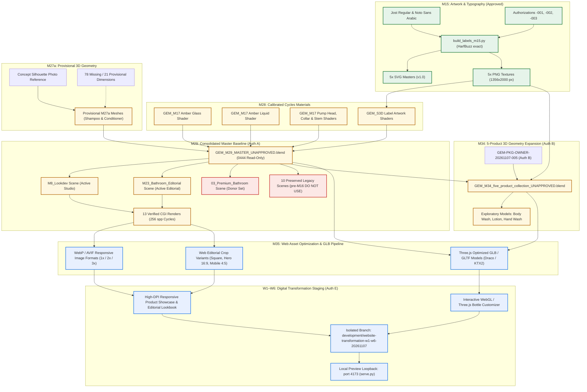

# GEM™ Asset Pipeline Dependency Graph (M33 Deliverable)

**Document Version:** 1.0  
**Release Date:** 2026-11-07  
**Scope:** M15 Artwork to M29 Master Scene, M34 Expansion, M35 3D/Static Pipeline, and W1–W6 Digital Staging  

---

## 1. End-to-End Asset Lineage & Dependency Flowchart

The following flowchart illustrates the strict unidirectional dependency flow across all packaging milestones, from approved typography and vector masters to web deployment:

---

## 2. Cryptographic Integrity and Pipeline Gates

| Pipeline Transition | Input Hashes / Artifacts | Output Hashes / Artifacts | Verification Gate & Status |
|---|---|---|---|
| **M15 → M28 Label Integration** | `textures/*.png` (`4a0942...`, `3f8048...`) | `GEM_M28_materials_UNAPPROVED.blend` | Direct node image packing; byte hashes identical (`verify_master.json`: `equal: true`). |
| **M27a + M28 → M29 Master Scene** | `GEM_M27_geometry_UNAPPROVED.blend` `GEM_M28_materials_UNAPPROVED.blend` | `GEM_M29_MASTER_UNAPPROVED.blend` `4d5ad586be1e8dc69d8e97fa3050a269a2ce7fe7d29d03eb83ba1f6e5e12ad39` | Executed via fresh Blender process; mesh vertices and material node-trees match exactly. Master blend locked `0444`. |
| **M29 Master → 13 Final CGI Renders** | Master `.blend` + embedded runner `M29_render.py` | 13 PNG images in `renders/final/*.png` | 256 spp Cycles render; verified against downsampled smoke test (`AB_master_smoke_vs_final.png` MAE 0.615–1.807 < 6.0 threshold). |
| **M29 Master → M34 5-Product 3D** | Master `.blend` + Owner Authorization B (`GEM-PKG-OWNER-20261107-005`) | `GEM_M34_five_product_collection_UNAPPROVED.blend` | Copies calibrated materials and donor geometry; attaches approved M15 labels for Body Wash, Lotion, Hand Wash. Classified as `PROVISIONAL_EXPLORATORY_GEOMETRY_M34`. |
| **M29 / M34 → M35 Web Assets** | 13 Final PNGs + 3D Product Collections | Optimized WebP/AVIF images + Draco-compressed GLB models | Automated asset pipeline generates responsive WebP/AVIF breakpoints and web-ready PBR GLB files. |
| **M35 → W1–W6 Website Staging** | Optimized GLB models + responsive images | Local preview server (`localhost:4173`) | Deployed exclusively on branch `development/website-transformation-w1-w6-20261107`. No production deployment without owner sign-off. |

---

## 3. Exclusion Boundaries

1. **Legacy Mesh Quarantine:** Scenes `00_Contact_Sheet`, `Scene`, `Scene.001`, `02_Hotel_Suite`, `04_Editorial_Still_Life`, `05_Product_Collection`, `Campaign_Night_Service`, `Study_Arrival_Cut`, `Product_Lookdev`, and `SAND3D_Pilot` are quarantined. Any pipeline tool reading mesh datablocks from these scenes will trigger a build error.
2. **Donor Scene Read-Only Isolation:** Scene `03_Premium_Bathroom` is referenced strictly as an architectural set donor. Its internal `S3 Products` collection must never be unlinked or substituted for production rendering.
3. **Exploratory Geometry Boundary:** Geometry created in M34 must remain explicitly tagged as `PROVISIONAL_EXPLORATORY_GEOMETRY_M34` in all GLTF metadata and manifest entries.
