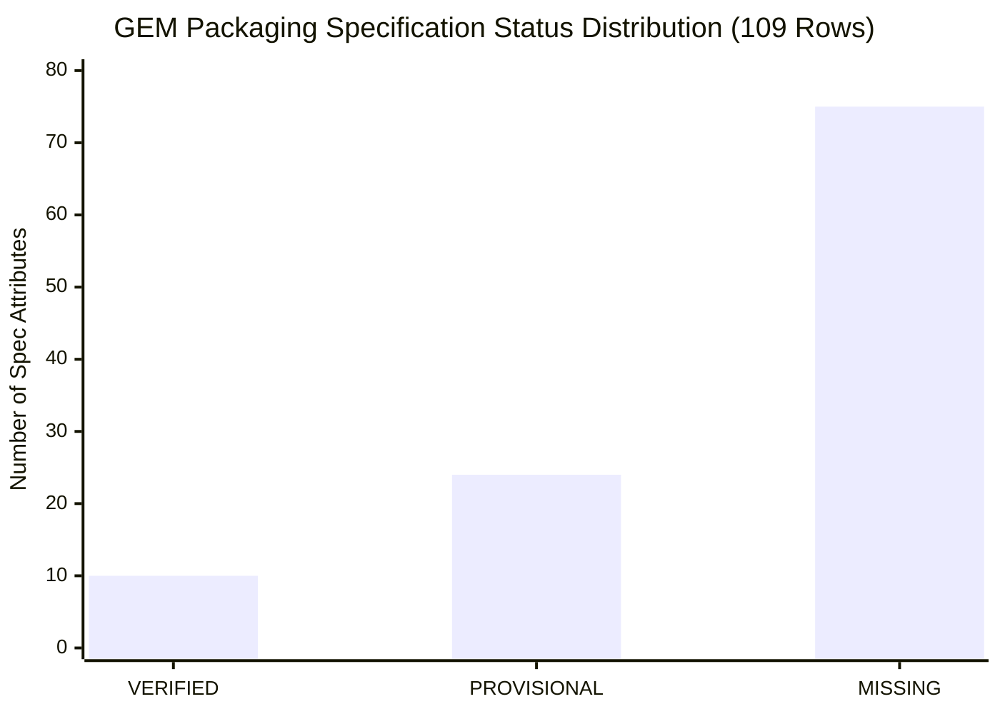

# M38 Supplier and Arabic Review Coordination Report

**Milestone:** GEM™ M38 Deliverable  
**Program:** GEM™ M33–M40 (Packaging & 3D Asset System) + W1–W6 (Digital Experience Transformation)  
**Date:** 2026-11-07  
**Governance Authority:**
- `GEM-PKG-OWNER-20261107-006` (Authorization C) — Native Arabic Typography Review.
- `GEM-PKG-OWNER-20261107-007` (Authorization D) — Supplier Information Requests.

---

> [!IMPORTANT]
> **TRANSMISSION STATUS SUMMARY: 0 TRANSMITTED / ALL READY FOR OWNER TRANSMISSION.**  
> An inspection of the workspace and execution environment confirms that no external communication tools (SMTP/API credentials, messaging bots, or outbound webhooks) exist, and no external reviewer or manufacturer contacts have been finalized in repository records. Therefore, in strict compliance with the project governance framework, all 4 coordination channels are classified as:  
> **`NOT SENT — READY_FOR_OWNER_TRANSMISSION`**.

---

## 1. External Coordination Channels & Transmission Status Ledger

| Channel ID | Target Stakeholder Category | Candidate Entity / Contact | Verification Status | Approved Disclosure Scope | Actual Status | Responses |
|---|---|---|---|---|---|---|
| `M38-CNT-01` | **Native Arabic Typography Reviewer** | Pending Owner Nomination | `PENDING_OWNER_SELECTION` | Locked Arabic names (`-002`), Layout A PNG labels at 100%/50%/14%, review questionnaire, dot simulations. Strictly no 3D scenes or governance files. | `NOT SENT — READY_FOR_OWNER_TRANSMISSION` | `NONE_YET` |
| `M38-CNT-02` | **Amber Glass Container Manufacturer** | Pending Owner Nomination | `PENDING_OWNER_SELECTION` | Nonbinding target capacity (250–350 mL), target OD (74–78 mm), target height (138–145 mm), neck finish (24/410 & 28/410). No CGI or unapproved dimensions. | `NOT SENT — READY_FOR_OWNER_TRANSMISSION` | `NONE_YET` |
| `M38-CNT-03` | **Dispensing Pump & Closure Supplier** | Pending Owner Nomination | `PENDING_OWNER_SELECTION` | Nonbinding inquiry for 24/410 & 28/410 lotion pumps, 1.5–2.0 mL output per stroke, horizontal spout, lock-down/twist-lock. No CAD files or POs. | `NOT SENT — READY_FOR_OWNER_TRANSMISSION` | `NONE_YET` |
| `M38-CNT-04` | **Label Stock & Embellishment Converter** | Pending Owner Nomination | `PENDING_OWNER_SELECTION` | Brand Hex colors (`#12171D`, `#BCACA7`), target panel dimensions (~80 × 118 mm), matte uncoated wet-strength intent. No print procurement. | `NOT SENT — READY_FOR_OWNER_TRANSMISSION` | `NONE_YET` |

---

## 2. Specification Tracking Gap Analysis (Missing Information Register)

The coordination strategy directly addresses the technical debt and missing data documented in `review/packaging-identity-M27-M32/m31_research/SPEC_TRACKING_MATRIX.csv` (109 total specification rows):

### Breakdown of Status Classifications:
1. **`VERIFIED` (10 rows):**  
   - Core brand decisions confirmed by the owner: 5 English product names, 5 locked Arabic names (`GEM-PKG-OWNER-20261107-002`), brand color palette (`#12171D`, `#BCACA7`), and bilingual Layout A geometry (`GEM-PKG-OWNER-20261107-003`).
2. **`PROVISIONAL` (24 rows — 21 baseline M24b + 3 added in M31):**  
   - Reference-derived physical geometry for Shampoo and Conditioner: body OD 76.3 mm, body height 141.5 mm, neck diameter 32 mm, neck height 12 mm, glass bead 34.2 mm, pump collar 38 mm, stem 26 mm, actuator 30.1 mm, spout reach ~48.7 mm, oblique nozzle cut ~53°, wall thickness 2.5 mm, base thickness 4.5 mm, fill fraction 0.9.  
   - *These remain provisional concept values and cannot be used for tooling.*
3. **`MISSING` (75 rows — 69 baseline M24b + 6 added in M31; representing 78 missing/provisional gap attributes across the 5 products):**  
   - Critical commercial manufacturing parameters completely unpopulated:
     - Container nominal capacities (mL) across all 5 products (Part A slide 22 leaves `[PENDING] mL`).
     - Standard neck thread specifications (turns, pitch, T/E/H/S dimensions).
     - Dispensing pump output dosage (mL per stroke) and formula viscosity ratings.
     - Dip tube interior cut length, notched profile, and internal bottom clearance.
     - Glass weight (grams), thermal shock resistance, and mold tooling cavity layout.
     - Regulatory back-label copy: 0 of 11 fields populated (INCI ingredients, warnings, country of origin, PAO symbol, storage conditions, barcode SKU).

---

## 3. Owner Actions Required Prior to Dispatch

To transition any channel from `NOT SENT` to `TRANSMITTED`, the project owner must execute the following specific steps:

1. **Arabic Review Dispatch:**
   - [ ] Select and nominate candidate reviewer(s) meeting the criteria in `QUALIFIED_ARABIC_REVIEWER_OUTREACH_PACKAGE.md`.
   - [ ] Confirm whether `OPTIONAL_owner_may_remove/` (exploratory left-edge and kerning comparison sheets) should remain in the package or be omitted.
   - [ ] Transmit the cover letter and verified attachment files from the owner's verified business email or messaging account.
   - [ ] Record the dispatch timestamp in `TRANSMISSION_STATUS_LEDGER.csv`.

2. **Supplier Inquiry Dispatch:**
   - [ ] Review and approve the target manufacturer shortlist for amber glass bottles, dispensing pumps, and label printers.
   - [ ] Review and approve the nonbinding technical inquiry wording in `SUPPLIER_INQUIRY_SAFEGUARD_PACKAGE.md`.
   - [ ] Ensure bilateral non-disclosure agreements (NDAs) are prepared if suppliers request proprietary product formulas.
   - [ ] Execute dispatch directly to technical applications engineering representatives.

---

## 4. Technical Implications for Downstream Milestones

### 4.1 Implications for M34 (5-Product 3D Geometry Expansion)
- Because supplier technical drawings and physical samples remain `MISSING` (Defects O1–O11 in `OWNER_INPUTS_REQUIRED.md`), 3D geometry for **Body Wash**, **Body Lotion**, and **Hand Wash** cannot be constructed as verified engineering specifications.
- **Resolution Strategy:** Under Owner Authorization B (`GEM-PKG-OWNER-20261107-005`), M34 proceeds by developing concept-level 3D procedural reference geometry that shares the GEM design language (amber glass cylinder, black pump, M15 bilingual label) while explicitly embedding the classification:
  `PROVISIONAL_EXPLORATORY_GEOMETRY_M34`.
- This unblocks visual development, UI layout, and Three.js staging without falsifying manufacturing data.

### 4.2 Implications for M36 (Visual Acceptance and QA)
- Visual acceptance testing must strictly segregate digital rendering quality from physical manufacturing accuracy.
- M36 will audit rendering fidelity, shader correctness, and texture sharpness against M29/M34 benchmarks, while maintaining a permanent defect flag against physical dimensional claims until supplier STEP/DWG drawings are ingested.

### 4.3 Handling Eventual Arabic Typography Responses
- Once a qualified reviewer completes `RESPONSE_FORM_TEMPLATE.md`:
  - Responses will be logged in `TRANSMISSION_STATUS_LEDGER.csv` as advisory evidence.
  - If the reviewer suggests typographic refinements (e.g. word spacing or dot adjustments), these will be compiled into an executive proposal for the project owner.
  - **No master artwork or Blender packed textures will be altered without an explicit owner authorization decision.**
