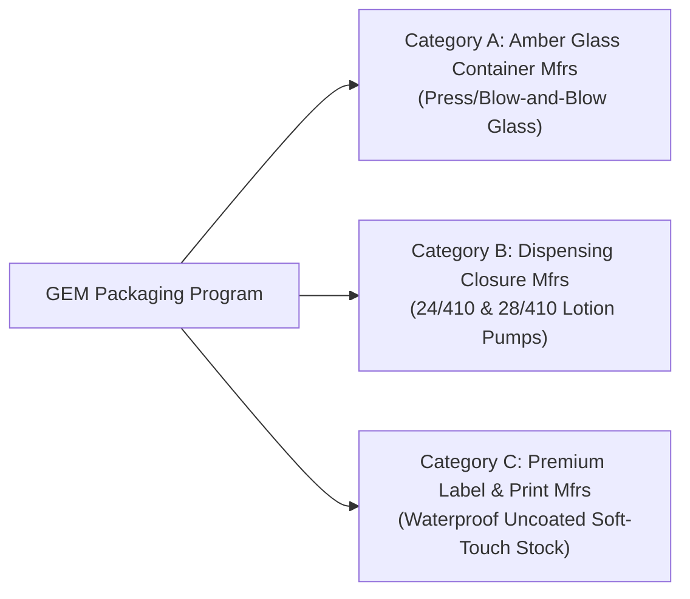

# Supplier Inquiry Safeguard Package (M38 Deliverable)

**Document Version:** 1.0  
**Release Date:** 2026-11-07  
**Governance Reference:** Owner Authorization D (`GEM-PKG-OWNER-20261107-007`)  
**Transmission Status:** `NOT SENT — READY_FOR_OWNER_TRANSMISSION`  
**Derived From:** `review/packaging-identity-M27-M32/m31_research/SUPPLIER_INFORMATION_REQUEST_V2.md`  

---

> [!WARNING]
> **PRE-TRANSMISSION SAFEGUARD NOTICE & SCOPE BOUNDARIES:**  
> This package has **NOT** been transmitted to any supplier or manufacturer. Under Owner Authorization D (`GEM-PKG-OWNER-20261107-007`), its purpose is strictly limited to nonbinding technical information gathering. No purchase orders, price acceptances, sampling fees, or NDAs are authorized. All provisional dimensions must be presented solely as concept target envelopes. CGI renders must **never** be attached.

---

## 1. Pre-Transmission Safeguard Checklist

Before any inquiry is released externally by the project owner, the following 10 verification gates must be certified:

- [ ] **Gate 1: Recipient Verification.** The supplier recipient entity, representative name, business domain, and verified physical facility address must be identified and verified. (Currently: *None identified in workspace*).
- [ ] **Gate 2: Zero CGI Attachment Rule.** Absolutely no Cycles CGI renders (`renders/final/*.png`), Blender 3D scene files (`*.blend`), or marketing beauty shots may be attached. CGI conveys misleading dimensional authority.
- [ ] **Gate 3: Explicit Concept Disclaimer.** All dimensional mentions (76.3 mm body diameter, 141.5 mm body height, 24/410 neck) must be labelled: *"Preliminary target design envelope for technical reference only; not an engineering specification."*
- [ ] **Gate 4: No Financial or Procurement Commitment.** The text must state that the inquiry constitutes a preliminary technical feasibility study and does not create a purchasing commitment, request for billing, or binding request for quotation.
- [ ] **Gate 5: Non-Disclosure & Confidentiality Protocol.** If proprietary tooling drawings or proprietary formulas are discussed, an owner-approved bilateral NDA must be executed prior to disclosure. No unilateral commitments may be accepted.
- [ ] **Gate 6: No Fabricated Quantities or Tolerances.** Minimum Order Quantities (MOQs), delivery lead times, and standard production tolerances must be requested from the supplier rather than stipulated as predetermined GEM specifications.
- [ ] **Gate 7: Back-Label Copy Exclusion.** Back-label text, regulatory declarations, INCI ingredient statements, barcode identifiers, and batch coding formats must be excluded (currently unpopulated in project records).
- [ ] **Gate 8: Dual-Sourced Neck Standard.** Inquiries must request standard catalogue options for both **24/410** and **28/410** thread finishes to prevent vendor lock-in.
- [ ] **Gate 9: Material Substrate Clarification.** Bottle substrate inquiries must specify USP Type III amber soda-lime glass or cosmetic-grade borosilicate glass, requesting standard press-and-blow or blow-and-blow tolerances.
- [ ] **Gate 10: Owner Executive Approval.** Explicit owner approval of the recipient list and outbound communication text must be recorded in the project ledger.

---

## 2. Candidate Manufacturer Categories & Profiles

GEM's architectural packaging system requires coordination across three distinct specialist manufacturing tiers:



### Category A: Amber Glass Hospitality Container Manufacturers
- **Target Products:** Shampoo, Conditioner, Body Wash, Body Lotion, Hand Wash containers.
- **Manufacturing Process:** Press-and-blow or blow-and-blow automated glass forming; mold tooling for cylindrical body profiles.
- **Key Technical Parameters Requested:**
  - Standard catalogue capacities within the target range: **250 mL – 350 mL** (nominal target ~300 mL).
  - Body diameter target envelope: **74.0 mm – 78.0 mm** (reference concept: 76.3 mm).
  - Body height target envelope: **138.0 mm – 145.0 mm** (reference concept: 141.5 mm).
  - Glass wall thickness profile: Nominal 2.0–3.0 mm body wall; reinforced 4.0–6.0 mm base band.
  - Base push-up / punt depth and inner floor radius.
  - Neck finish standards supported: GCMI 24/410 or 28/410; neck bead (transfer ring) dimensions and thread pitch.
  - Glass colorimetry: Deep amber UV-filtering glass (transmission cut-off < 450 nm).
  - Surface treatment: Hot-end and cold-end coatings suitable for automated pressure-sensitive label application.

### Category B: Dispensing Pump & Closure Manufacturers
- **Target Components:** Dispensing pump assemblies, threaded collars, actuator heads, horizontal spouts, dip tubes.
- **Manufacturing Process:** Precision injection-molded polyolefin (PP/PE) with metal spring and elastomeric ball valve.
- **Key Technical Parameters Requested:**
  - Thread compatibility: GCMI 24/410 and 28/410 screw collars (smooth wall, matte finish preferred; optional aluminum/metal shell over-sleeve).
  - Dispensing output: **1.5 mL to 2.0 mL per stroke** (for high-viscosity body lotion and moderate-viscosity shampoo/gel).
  - Lock mechanism: Lock-down (screw-down) or 90° twist-lock with audible tactile detent.
  - Actuator geometry: Low-profile cylindrical hub (8–10 mm height), horizontal spout reach (45–50 mm), angled droplet cut.
  - Dip tube specification: Translucent or clear polyolefin tube, matched to container interior floor height with angled notched cut.
  - Viscosity compatibility envelope: Formulations from 1,500 cPs (hand wash) to 25,000 cPs (hair conditioner / rich lotion).

### Category C: Premium Label Stock & Embellishment Converters
- **Target Components:** Front pressure-sensitive cylindrical body wrap labels.
- **Manufacturing Process:** Narrow-web rotary flexography / digital offset with inline die-cutting and tactile embellishment.
- **Key Technical Parameters Requested:**
  - Face stock options: Warm uncoated or lightly textured matte stock with moisture-resistant and oil-resistant wet-strength barrier.
  - Adhesive formulation: Permanent emulsion acrylic adhesive resistant to warm water immersion, shower humidity, and surfactant exposure.
  - Dimensional compatibility: Printable panel target ~80 mm width × 118 mm height (covering ~120° bottle wrap arc).
  - Color reproduction: Solid ink coverage matching Hex `#12171D` (Ink field) with crisp knock-out or spot-printed Beige `#BCACA7` typography.
  - Embellishment capabilities: Micro-embossing, debossing, or blind textural stamping without substrate cracking.
  - Minimum legible stroke width: Capability to reproduce 0.15 mm fine Arabic diacritic dots and Latin serifs.

---

## 3. Sanitised Technical Inquiry Brief (Nonbinding External Draft)

*(Formulated for external technical dispatch by project owner — strictly technical, zero commitments)*

```markdown
To: Technical Applications Engineering / Commercial Sales  
From: GEM™ Packaging Development Team  
Subject: Technical Information Request: Packaging Components for Luxury Personal-Care Hospitality Collection  

Dear Technical Team,

GEM™ is currently evaluating manufacturing options for a luxury personal-care amenity collection comprising five products (Shampoo, Conditioner, Body Wash, Body Lotion, and Hand Wash). We are seeking standard catalogue technical documentation, drawing packages, and compatibility guidelines for your component offerings.

### Nature of this Inquiry:
This inquiry is an exploratory technical feasibility assessment to establish dimensional compatibility and standard catalogue options. This communication does not constitute a purchase order, procurement commitment, or request for customized billable tooling.

### Component Requirements & Target Design Envelopes:

1. Amber Glass Containers (Bottles):
   • Capacity: Standard sizes within the 250 mL – 350 mL range (target nominal 300 mL).
   • Silhouette: Straight-sided cylindrical body, soft radius shoulder, weighted base.
   • Target Dimensional Envelope: Body OD ~74–78 mm; Container Height to neck shoulder ~138–145 mm.
   • Neck Finish: Standard GCMI 24/410 or 28/410 thread finish.
   • Material: Amber glass with UV protection properties.

2. Lotion Dispensing Pumps:
   • Closure Size: 24/410 or 28/410 threaded collar (matte black or dark anthracite smooth finish).
   • Dispensing Dosage: 1.5 mL to 2.0 mL nominal output per stroke.
   • Lock Type: Lock-down or 90° twist-lock.
   • Viscosity Range: Suitable for personal-care liquids and creams (2,000–25,000 cPs).
   • Spout Profile: Contemporary horizontal spout profile.

3. Pressure-Sensitive Labels:
   • Substrate: Water- and oil-resistant warm matte uncoated face stock.
   • Dimensions: Target die-cut envelope ~80 mm (width) × 118 mm (height).
   • Application: High-speed automated roll application on cylindrical glass.

### Requested Documentation:
We kindly request that you provide:
• Standard technical drawings (PDF and 3D CAD: STEP or IGES format where available) indicating critical dimensions, neck finish details, and production tolerances.
• Available standard catalogue capacities, minimum order quantities (MOQs), and standard sample lead times.
• Standard material specification sheets and regulatory compliance certifications (e.g. food contact, REACH/SVHC, heavy metal limits).

Please reply to [Owner Email Contact] with relevant technical product literature.

Sincerely,

[Project Owner / Procurement Lead]  
GEM™ Packaging & Product Development
```
