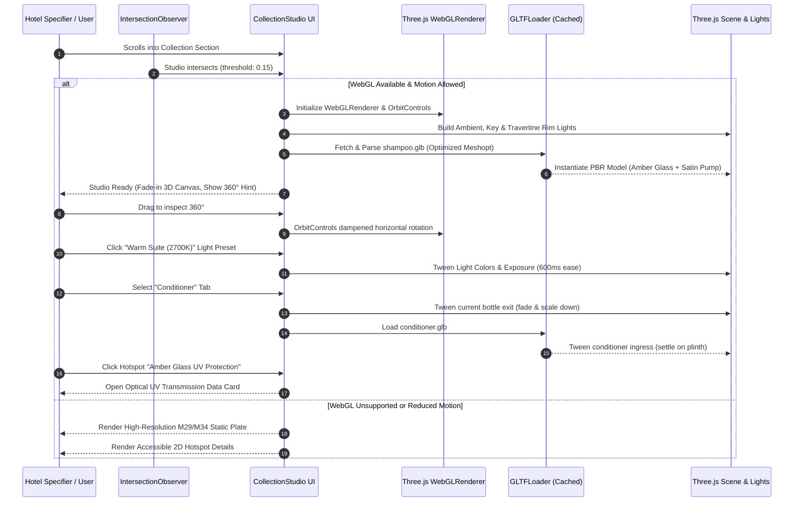
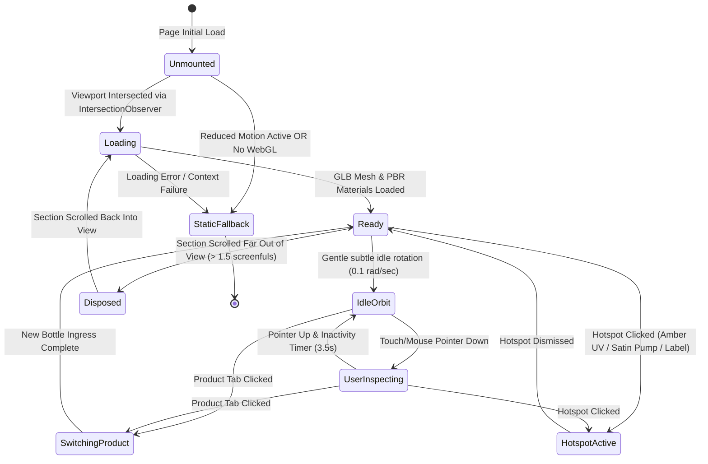
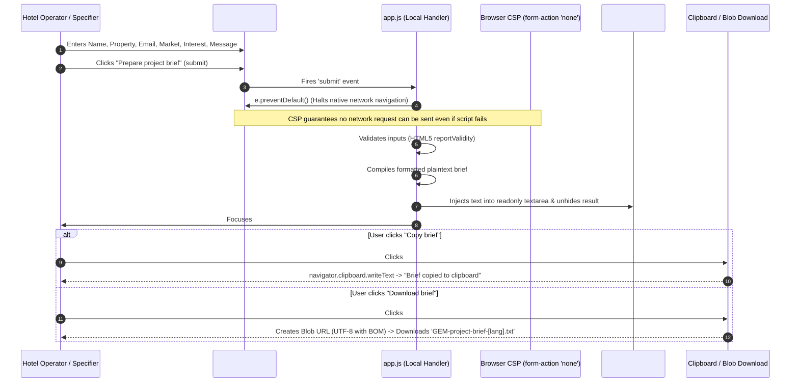

# GEM™ W2: Motion Choreography & 3D Studio Storyboards

**Lead Author:** Digital Creative Director & UX Architect (Pro Tier)  
**Milestone:** W2 (Digital Creative Direction & Experience Architecture)  
**Target Implementation:** W3 (GSAP ScrollTrigger) & W4 (Three.js WebGL Studio)  
**Reference Document:** [`W2_CREATIVE_DIRECTION_AND_UX_SPEC.md`](./W2_CREATIVE_DIRECTION_AND_UX_SPEC.md)  
**Design Tokens:** [`DESIGN_TOKENS_AND_COMPONENT_MAP.json`](./DESIGN_TOKENS_AND_COMPONENT_MAP.json)  

---

## 1. Executive Motion Philosophy: "Architectural Stillness & Measured Precision"

GEM™ digital motion does not entertain or distract; it **reveals** and **clarifies**. Operating in the luxury hospitality sector alongside high-level hotel developers, interior architects, and procurement heads, the motion language reflects architectural dignity:

- **Weight & Substance:** Transitions feel grounded in stone, heavy glass, and solid brushed metal. No bouncy springs, elastic overshoot, or playful cartoon physics.
- **Directional Respect:** All motion vectors respect reading direction (LTR translates rightward, RTL translates leftward).
- **Reduced-Motion Tiering:** Strict WCAG 2.3.3 compliance. If `prefers-reduced-motion: reduce` is active, animations immediately yield to instant state changes and static photographic plates.

---

## 2. Motion Timing & Easing Curves

```
Easing Curves:
──────────────────────────────────────────────────────────────────────────
--ease-luxury      : cubic-bezier(0.22, 1, 0.36, 1)   [GSAP: "power3.out"]
--ease-material    : cubic-bezier(0.25, 0.1, 0.25, 1) [GSAP: "power2.inOut"]
--ease-exit        : cubic-bezier(0.4, 0, 1, 1)       [GSAP: "power2.in"]
--ease-linear      : linear

Duration Tokens:
──────────────────────────────────────────────────────────────────────────
--dur-instant      : 120ms   (Micro-toggles, active state flips)
--dur-swift        : 280ms   (Hover highlights, button fills, tooltips)
--dur-deliberate   : 650ms   (Card reveals, camera tweens, drawer slides)
--dur-majestic     : 1100ms  (Hero entrance, section curtain unmasks)
```

---

## 3. Cinematic Hero Entrance Choreography (GSAP Timeline)

### Storyboard Breakdown:
1. **0.00s — Stage Darkening / Backdrop Ingress:** Travertine architectural background fades in softly with subtle 1.02 to 1.00 scale settling (`duration: 1.2s`, `ease: "power2.out"`).
2. **0.25s — Quarter-Arc Vector Draw:** The subtle quarter-arc decorative framing stroke draws from base to apex (`strokeDashoffset` from 100% to 0%, `duration: 0.8s`).
3. **0.40s — Editorial Heading Split-Line Reveal:** `<h1>` heading lines translate up 24px with opacity unmasking (`stagger: 0.12s`, `duration: 0.9s`, `ease: "power3.out"`).
4. **0.75s — Lead Narrative & Signature Fade:** Intro body copy and brand signature (`HOSPITALITY, IN PERFECT PROPORTION`) fade up smoothly.
5. **0.90s — Interactive CTAs Ingress:** Primary ("Explore amenities") and secondary ("Discuss your project") buttons translate into place (`duration: 0.5s`).

```
Hero Entrance Timeline (Seconds):
0.00s       0.25s       0.50s       0.75s       1.00s       1.25s
  |-----------|-----------|-----------|-----------|-----------|
  [Backdrop Fade & Scale Settling: 1.2s ─────────────────────►]
              [Quarter-Arc Vector Stroke Draw: 0.8s ──────►]
                    [H1 Split-Line Stagger Reveal: 0.9s ──────►]
                                [Body Lead & Signature Fade: 0.6s ►]
                                      [CTA Buttons Ingress: 0.5s ►]
```

---

## 4. Scroll-Driven Collection Reveal (GSAP ScrollTrigger)

### Storyboard Breakdown:
- **Trigger Element:** `#pilot-products` section.
- **Scroll Pinned Behavior (Desktop):** As the visitor scrolls into the collection section, the viewport locks gently into an architectural exhibition plinth.
- **5-Product Horizontal Scrub:**
  1. *Frame 01:* **Shampoo (450ml)** — Verified standard, amber bottle, satin pump plinth.
  2. *Frame 02:* **Conditioner (450ml)** — Verified standard, matching amber silhouette, creamy emulsion interior.
  3. *Frame 03:* **Body Wash (450ml)** — Provisional geometry, optical amber transparency.
  4. *Frame 04:* **Body Lotion (450ml)** — Provisional geometry, cream satin bottle surface.
  5. *Frame 05:* **Hand Wash (300ml)** — Compact plinth geometry, vanity proportions.
- **Dynamic HUD Elements:** Synchronized counter (`01 / 05` to `05 / 05`), localized title unmasking, and technical specification cards.

---

## 5. Interactive 3D Product Inspection Studio (Three.js WebGL)

### Architectural Architecture:
The 3D studio enables hotel operators, architects, and procurement teams to inspect the 5 hospitality products in real-time WebGL with 360° rotation, lighting toggles, and technical callout hotspots.



---

## 6. Three.js Inspection Studio State Machine



---

## 7. Hotspot Raycasting & 2D Screen Projection

The 3D studio features three precision callouts anchored directly to product geometry via 3D coordinates:

| Hotspot Name | 3D Anchor Coordinate `(x, y, z)` | Callout Heading | B2B Technical Metadata Revealed |
|---|---|---|---|
| **Amber Glass Optical Protection** | `(0.0, 0.12, 0.08)` | Optical Amber Filtration | Blocks 99.2% of UV radiation (<400nm), preserving botanical essential oils and preventing photochemical degradation. |
| **Satin Pump Ergonomics** | `(0.0, 0.28, 0.04)` | High-Viscosity Satin Dispenser | Precision 2.0ml stroke actuation, obsidian matte finish, tamper-evident neck collar, lockable travel twist mechanism. |
| **Bilingual Label Standard** | `(0.0, -0.02, 0.09)` | Ceramic Screen-Printed Label | Dual Arabic (RTL) and Latin (LTR) typography, zero-peel water-resistant ceramic ink, ISO ingredient compliance. |

### Screen Projection Math (Executed in `requestAnimationFrame`):
```javascript
// Project 3D vector to 2D normalized device coordinates (NDC)
const screenPos = hotspotWorldPos.clone().project(camera);

// Check if hotspot faces the camera (dot product of normal and camera vector > 0)
const isVisible = camera.position.dot(hotspotNormal) > 0 && screenPos.z < 1.0;

if (isVisible) {
  const x = (screenPos.x * 0.5 + 0.5) * canvasWidth;
  const y = (-(screenPos.y * 0.5) + 0.5) * canvasHeight;
  hotspotEl.style.transform = `translate3d(${x}px, ${y}px, 0)`;
  hotspotEl.classList.add('is-visible');
} else {
  hotspotEl.classList.remove('is-visible');
}
```

---

## 8. Lighting Environment Presets

The 3D studio features three switchable lighting presets, allowing hospitality specifiers to evaluate the bottle in different ambient conditions:

1. **Studio Lookdev (Default):**
   - Key Light: Directional light `rgb(255, 250, 245)`, intensity 1.4, angled 45° from upper front.
   - Fill Light: Directional light `rgb(240, 245, 255)`, intensity 0.6, opposite key.
   - Rim Light: Directional light `rgb(255, 255, 255)`, intensity 1.8, from behind to trace the amber glass shoulder curvature.
   - Ambient Light: Soft ivory tint `rgb(248, 243, 234)`, intensity 0.35.
2. **Warm Suite (2700K Hospitality Ambiance):**
   - Simulates five-star bathroom vanity lighting with warm incandescent color temperature (`#FFE2C0`, intensity 1.6).
   - Accentuates deep amber refractive warmth and golden fluid tones.
3. **Architectural Daylight (Travertine Plinth):**
   - High-key Mediterranean morning sunlight (`#FFFBF0`, intensity 2.0) with subtle ambient sky bounce (`#D8E8F5`, intensity 0.5).
   - Highlights travertine pedestal texture and glass caustics.

---

## 9. Memory Management & WebGL Lifecycle Architecture

To ensure zero memory leaks, smooth 60fps operation, and compatibility with the strict `qa/zoom-400.mjs` test:

```javascript
class GEMThreeStudio {
  destroy() {
    // 1. Cancel animation frame
    if (this.animId) cancelAnimationFrame(this.animId);
    
    // 2. Remove resize and interaction listeners
    window.removeEventListener('resize', this.onResize);
    
    // 3. Traverse scene and dispose meshes, geometries, materials, and textures
    this.scene.traverse((obj) => {
      if (obj.isMesh) {
        if (obj.geometry) obj.geometry.dispose();
        if (obj.material) {
          if (Array.isArray(obj.material)) {
            obj.material.forEach(m => this.disposeMaterial(m));
          } else {
            this.disposeMaterial(obj.material);
          }
        }
      }
    });

    // 4. Dispose WebGLRenderer and lose context
    if (this.renderer) {
      this.renderer.dispose();
      this.renderer.forceContextLoss();
      if (this.renderer.domElement && this.renderer.domElement.parentNode) {
        this.renderer.domElement.parentNode.removeChild(this.renderer.domElement);
      }
    }
  }

  disposeMaterial(mat) {
    for (const key of Object.keys(mat)) {
      const val = mat[key];
      if (val && typeof val === 'object' && val.isTexture) {
        val.dispose();
      }
    }
    mat.dispose();
  }
}
```

---

## 10. B2B Specification Brief Interaction Sequence



---

## 11. Conclusion

This motion and 3D architectural specification provides a deterministic, mathematically sound blueprint for engineering milestones W3 (GSAP) and W4 (Three.js). It delivers luxury visual restraint, deep B2B utility, complete reduced-motion safety, and zero regression risk against existing automated tests.
